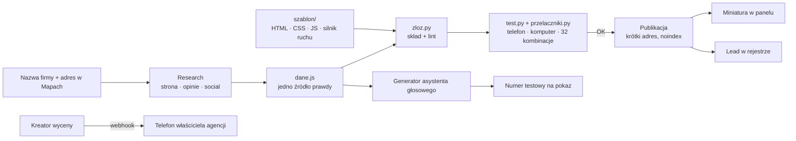
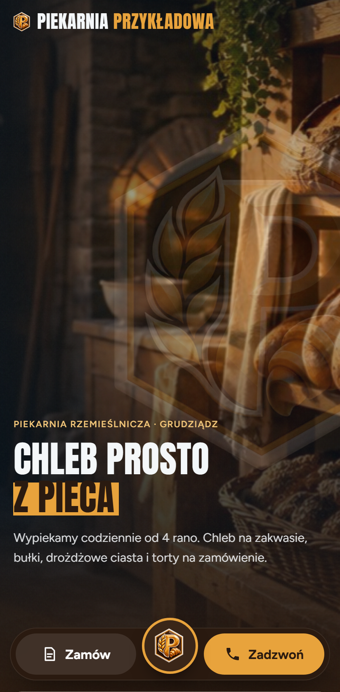
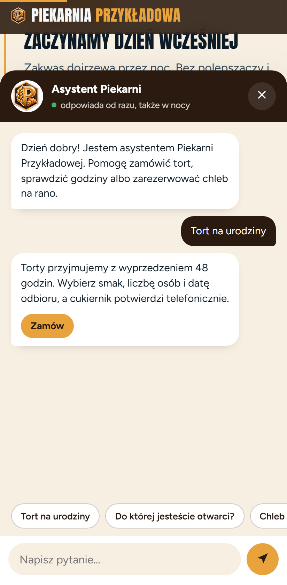
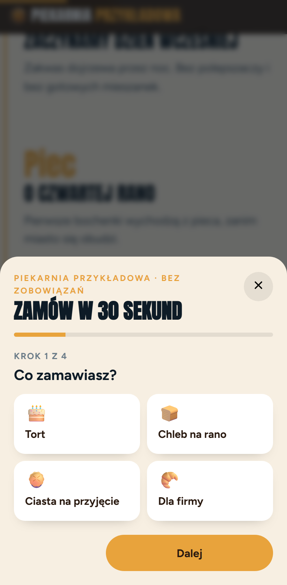
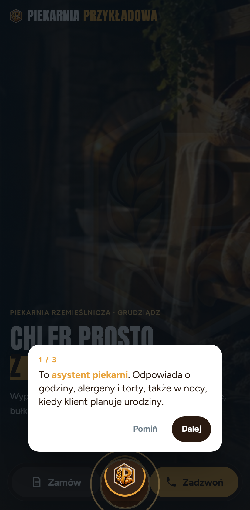
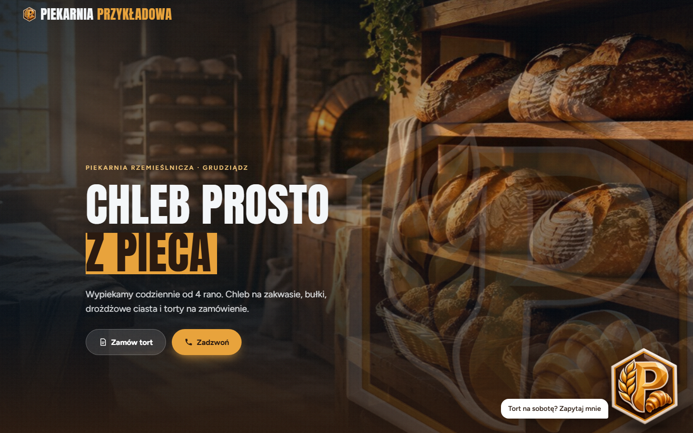
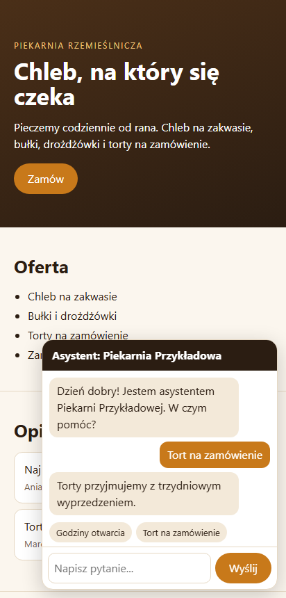
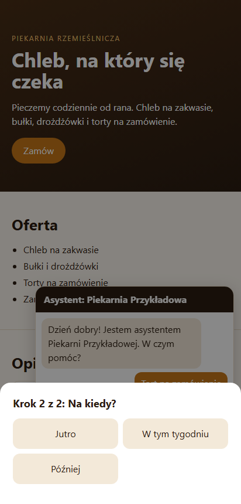
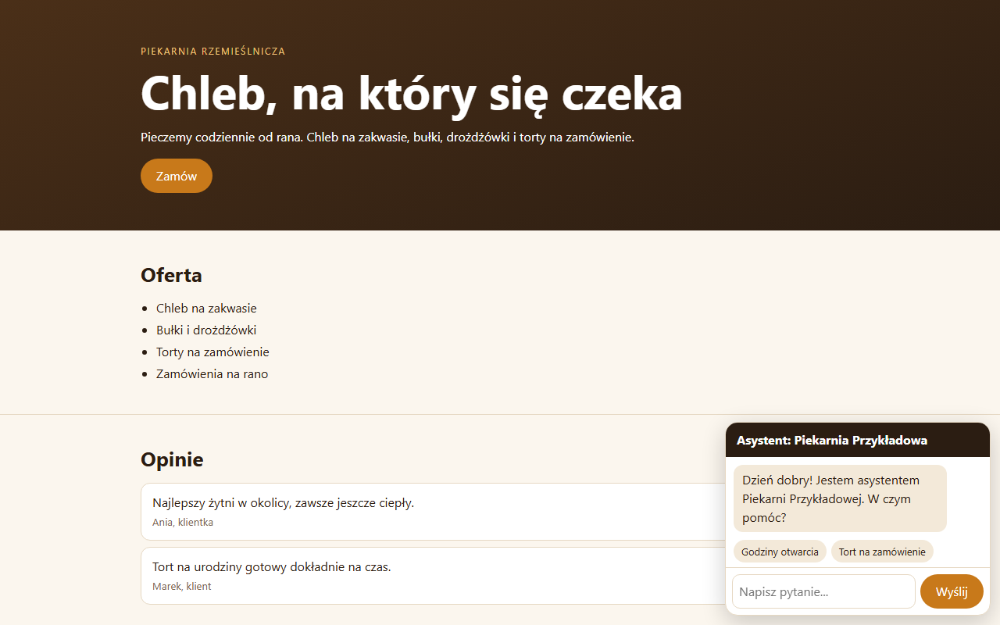
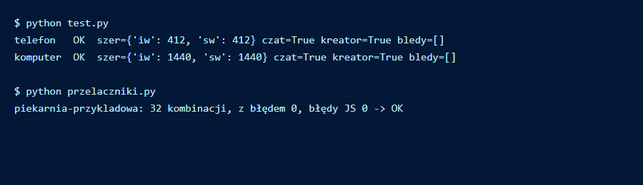

# AI Prototype Builder

Na wejściu firma. Na wyjściu działający prototyp jej strony: z ruchem, czatem z maskotką firmy, kreatorem wyceny, który naprawdę wysyła zgłoszenie, cennikiem i asystentem głosowym do pokazu przez telefon.

*Company in, working website prototype out: motion, a chat with the company's own mascot, a quote wizard that really sends, a pricing page and a voice assistant demo.*

> Wizytówka projektu. Prototypy prawdziwych firm nie są publikowane; zrzuty pochodzą z firmy fikcyjnej. / Showcase repository. Real client prototypes are not published; screenshots use a fictional company.

---

## PL

### Problem
Właściciel lokalnej firmy nie kupi „strony z AI” z opisu. Musi zobaczyć swoją firmę, swoje logo i swój telefon, który dzwoni. Ręczne robienie takiego pokazu dla każdego leada trwa dni.

### Rozwiązanie
Szablon sterowany danymi plus proces prowadzony przez agenta Claude Code (skill):
1. **Research tożsamości**: strona, wizytówka w Mapach, social media właściciela. Szuka jednego motywu, który jest *ich* (przydomek z opinii, rok założenia, znak z logo).
2. **Jeden plik danych na firmę** (`firmy/<firma>/dane.js`): hero, oferta, opinie, czat, kreator, pokaz, cennik. Sekcja bez danych sama znika.
3. **Składanie** (`zloz.py`): szablon plus dane, lint tekstu (zakazane znaki), podgląd linku dla komunikatorów.
4. **Testy** (`test.py`, `przelaczniki.py`): telefon i komputer, szerokość co do piksela, wszystkie 32 kombinacje modułów prototypu muszą dać zero błędów.
5. **Publikacja** pod krótkim adresem z `noindex`, automatyczna miniatura do panelu.
6. **Asystent głosowy demo** generowany z tego samego `dane.js` i podpinany pod numer testowy przed wizytą.

### Architektura



### Decyzje projektowe
- **Czat w prototypie bez LLM.** Odpowiedzi ze słów kluczowych z `dane.js`: działa offline i nie powie głupstwa przy właścicielu.
- **Kreator nie podaje ceny.** Kończy podsumowaniem i wysyła zgłoszenie naprawdę; pokaz brzmi „z Twojego telefonu na mój, od razu”.
- **Awatar czatu z prawdziwego znaku firmy**, nie z generatora postaci; logo słabej jakości przerysowane wiernie w SVG.
- **Koszt mierzony na każdym prototypie** (czas, tokeny, kredyty grafiki), bez generowanego wideo w standardzie.
- **Wiedza agenta demo tylko z `dane.js`.** Katalogi asystentów demo są generowane i nadpisywane, więc nie da się ich rozjechać ręczną poprawką.
- **Tryb anonimowy** (`?anon`) do materiałów marketingowych, dopóki właściciel nie zgodzi się na piśmie.

### Wybrany fragment (dane firmy fikcyjnej)

```js
window.DANE = {
  firma: 'Piekarnia Przykładowa',
  hero: { tytul: 'Chleb, na który się czeka', znak: 'assets/znak.svg' },
  czat: {
    podpowiedzi: ['Godziny otwarcia', 'Tort na zamówienie'],
    odpowiedzi: [{ slowa: ['tort', 'zamówienie'], tekst: 'Torty przyjmujemy z trzydniowym wyprzedzeniem.' }],
    domyslna: 'Zostaw numer, oddzwonimy jeszcze dziś.'
  },
  kreator: { kroki: [{ typ: 'kafle', pytanie: 'Na kiedy?', opcje: ['Jutro', 'W tym tygodniu', 'Później'] }] }
};
```

### Stack
HTML, CSS, JavaScript, GSAP + ScrollTrigger + Lenis (ruch), Python (skład, testy, publikacja), Playwright (testy telefon i komputer), generowanie obrazów przez API, n8n (webhook kreatora), Vapi (asystent głosowy demo), Claude Code (skill prowadzący proces).

### Efekt
28 prototypów zbudowanych na jednym szablonie (stan na 7.10.2026). Każdy przechodzi te same testy przed publikacją, a jego asystent głosowy powstaje z tych samych danych.

---

## EN

**Problem.** A local business owner will not buy an "AI website" from a description. They need to see their own company, logo and a phone that actually rings. Building that demo by hand for every lead takes days.

**Solution.** A data-driven template plus a Claude Code skill that runs the process: identity research (website, maps listing, owner's social media), one data file per company, build with text lint, phone and desktop tests including all 32 module combinations, publishing under a short `noindex` address with an automatic dashboard thumbnail, and a demo voice assistant generated from the same data file.

**Design decisions.** No LLM in the prototype chat (keyword answers: works offline, never embarrasses). The quote wizard gives no price and really sends the request. Chat avatar from the company's real mark. Cost measured per prototype. Demo assistant knowledge comes only from the data file. Anonymous mode for marketing until written consent.

**Result.** 28 prototypes built on one template (as of 2026-10-07), each passing the same test gate.

## Zrzuty z generatora / Screenshots from the generator

Firma fikcyjna „Piekarnia Przykładowa”, zbudowana pełnym generatorem (z warstwą handlową, której tu nie publikujemy). / Fictional company built with the full generator (including the commercial layer, which is not published here).

| Otwarcie / Hero | Czat / Chat | Kreator / Quote wizard | Pokaz / Guided tour |
|---|---|---|---|
|  |  |  |  |



## Jak uruchomić / Run it

W repozytorium jest minimalny, działający szkielet tego samego pomysłu: szablon, `dane.js` firmy fikcyjnej, skład z lintem, test na telefonie i komputerze oraz sprawdzenie wszystkich 32 kombinacji modułów. Bez ruchu, grafik, głosu i warstwy handlowej.
*A minimal working skeleton of the same idea: template, fictional `dane.js`, build with lint, phone and desktop test, and all 32 module combinations. Without motion, imagery, voice and the commercial layer.*

```bash
pip install -r requirements.txt && playwright install chromium
python zloz.py piekarnia-przykladowa     # składa dist/piekarnia-przykladowa/index.html
python test.py                           # telefon 412 px i komputer 1440 px
python przelaczniki.py                   # 32 kombinacje modułów
```

Gotowy plik do obejrzenia bez budowania: `demo/piekarnia-przykladowa.html`. Struktura: `template/` (HTML, CSS, JS), `firmy/<firma>/dane.js`, `zloz.py`, `test.py`, `przelaczniki.py`.

| Czat i podpowiedzi / Chat | Kreator bez ceny / Wizard, no price | Komputer / Desktop |
|---|---|---|
|  |  |  |

Wynik testów minimalnego przykładu / Test output of the minimal example:



---

<p align="center"><br>
Zbudowane w <a href="https://cyfrownia.com">Cyfrowni</a>, agencji AI z Grudziądza. Kontakt: <a href="mailto:biuro@cyfrownia.com">biuro@cyfrownia.com</a></p>
